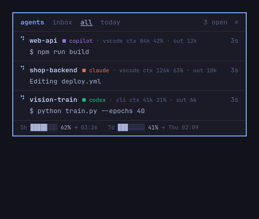

# agent-inbox

One inbox for your coding agents. A floating overlay for Linux that shows what every agent session on your machine is doing (Claude Code, Codex, GitHub Copilot, Antigravity), pops up when one needs you, and lets you answer without switching windows.



- **Sees every session.** Any terminal, any folder, any editor, through each agent's own hook system. Every card is tagged with its agent.
- **Works like an inbox.** A session appears when it asks for permission, asks a question, fails, or finishes a long turn. It disappears once you have dealt with it.
- **Answer from the overlay.** Approve or deny a permission prompt. Answer the agent's questions by picking options or typing your own reply, including multi-part and multi-select questions. The prompt in the terminal keeps working too; whichever you answer first wins.
- **Token counts.** Each card shows the session's current context size and total output tokens.
- **Today.** A third tab lists today's turns across all projects: when, how long, how many tool calls, the prompt and how it ended.
- **Themes.** Tokyo Night, Catppuccin, Gruvbox and Nord.
- **Plan usage.** On Pro and Max plans the overlay shows how much of the 5-hour and 7-day limits you have used, and warns you when you cross a threshold.
- **Stays out of the way.** Sits above other windows, only takes keyboard focus when you click a reply box, hides itself when nothing needs you.
- **Local only.** One unix socket, no network port, no telemetry.

Status: v0.2, tested on KDE Plasma 6 (Wayland) with Claude Code 2.1. All states and themes: [docs/preview.png](docs/preview.png).

## Requirements

- A Wayland compositor with layer-shell support. KDE Plasma 6 is tested. Hyprland, Sway and niri should work but are untested. GNOME and X11 are not supported.
- Python 3.10+, PySide6, layer-shell-qt, a systemd user session.
- Claude Code.

Arch / CachyOS:

```
sudo pacman -S --needed pyside6 layer-shell-qt
```

Other distributions: install PySide6 (with QtQuick) and layer-shell-qt from your package manager. PySide6 from pip will not work for the overlay, because layer-shell-qt has to match the Qt it runs in.

## Install

```
git clone https://github.com/vp916/agent-inbox.git
cd agent-inbox
python3 install.py install
```

This does three things, all reversed by `python3 install.py uninstall`:

| Change | Where |
|---|---|
| Hook entries (your existing settings are kept, a backup is made first) | `~/.claude/settings.json` |
| A status line showing model, context and plan usage (only if you have none) | `~/.claude/settings.json` |
| Two user services: daemon and overlay | `~/.config/systemd/user/agent-inbox*.service` |
| The `agent-inbox` command | `~/.local/bin/agent-inbox` |

The hooks and services point at the cloned folder. If you move it, run install again.

Sessions that are already open pick the hooks up on their own; if one does not show, restart it.

Arch users can also build a package from [`packaging/aur/PKGBUILD`](packaging/aur/PKGBUILD) with `makepkg -si`, then run `agent-inbox-setup install` as your user.

### Hotkey

Bind `agent-inbox toggle` to a key.

- KDE: System Settings → Keyboard → Shortcuts → Add New → Command.
- Hyprland: `bind = SUPER, A, exec, agent-inbox toggle`

## Using it

The overlay stays hidden until something needs you, then appears in a corner of the screen:

| Card | Meaning | What you can do |
|---|---|---|
| `allow?` | waiting on a permission prompt | approve, deny, or answer in the terminal |
| `asks` | the agent asked a question | pick options or type a reply, or answer in the terminal |
| `plan` | a plan is ready for review | read it under `more`; approve it in the terminal (click the card to jump there) |
| `done` | a long turn finished | dismiss, or just send the next prompt |
| `error` | the turn failed | dismiss |

Click a card to jump to that session's terminal window (KDE: also switches to the right Konsole tab; Hyprland and Sway are supported but untested). `more` (shown on hover) expands a card: the prompt you gave and the last few actions. `stop` (shown on hover) ends that session after a confirmation click. The `all` tab lists every open session, including the ones working quietly. The `today` tab is a history of today's turns.

To keep it quiet while you are already at the terminal, a permission prompt or question only pops the overlay up if it is still unanswered after 4 seconds, and "done" only counts for turns longer than 30 seconds. Both are configurable.

From the terminal:

```
agent-inbox status                 list sessions
agent-inbox watch                  live list
agent-inbox toggle | show | hide   overlay visibility
agent-inbox view inbox|all|today   sessions that need you, everything, or today's history
agent-inbox history                today's turns in the terminal
agent-inbox dismiss [id]           clear "needs you" on one session or all
agent-inbox approve <id>           approve a permission prompt
agent-inbox deny <id>              deny it
agent-inbox answer <id> <a>...     answer a question: one answer per part (an option or any text)
agent-inbox focus <id>             bring that session's terminal to the front
agent-inbox stop <id>              end a session
```

`<id>` is any unique prefix of the session id shown by `status`.

## Configuration

Optional. Create `~/.config/agent-inbox/config.json` with any of these keys (defaults shown), then `systemctl --user restart agent-inbox`:

```json
{
  "position": "top-right",
  "margin": 14,
  "width": 460,
  "font": "",
  "alert_delay": 4,
  "done_min_turn": 30,
  "keep_days": 14,
  "sound": true,
  "theme": "tokyo-night",
  "usage_warn": 80
}
```

- `position`: `top-right`, `top-left`, `bottom-right` or `bottom-left`.
- `font`: a font family. Empty picks the first installed one from a built-in list of monospace fonts.
- `alert_delay`: seconds a permission prompt or question must stay unanswered before the overlay pops up.
- `done_min_turn`: seconds a turn must run before "finished" counts as needing you.
- `keep_days`: how long the event log is kept.
- `theme`: `tokyo-night`, `catppuccin`, `gruvbox` or `nord`.
- `usage_warn`: percentage of the 5-hour or 7-day plan limit at which you get a warning notification.
- `sound`: play a short sound when the overlay pops up (needs `pw-play` or `paplay` and the freedesktop sound theme).

## How it works

```
Claude Code hooks -> hook/agent_inbox_hook.py -> unix socket -> daemon/daemon.py -> ui/overlay.py
```

- **Hook script.** Forwards each hook event to the daemon and exits. It runs in the background, takes about 15 ms, and exits cleanly if the daemon is not running, so it never slows or blocks the agent. The one hook that waits is the permission request: it holds on for an answer from the overlay while Claude Code shows its own prompt as usual.
- **Daemon.** Keeps one state per session (`daemon/state.py`, a small pure state machine), decides what needs attention and when to pop the overlay up, and removes sessions whose process has gone.
- **Overlay.** A PySide6/QML window placed with layer-shell. `ui/Panel.qml` is the whole look; `ui/Preview.qml` renders it with sample data.

## Supported agents

Each card carries a coloured tag naming the agent and where it runs (`■ claude · cli`, `■ codex · cli`, `■ copilot · vscode`).

| Agent | Shown in the overlay | Answer from the overlay | State |
|---|---|---|---|
| Claude Code (terminal, VS Code extension) | actions, permission, questions, plans, done, errors | approve / deny, options, typed replies | tested |
| Codex CLI | actions, permission, done | approve / deny | tested live |
| GitHub Copilot (CLI and the VS Code agent) | actions, permission, done, errors | approve / deny | watching tested live in VS Code; answering simulated only |
| Antigravity | actions (after each tool call), done | no | simulated events only |

The installer adds hooks for every agent it finds on the machine:

| Agent | Hooks file |
|---|---|
| Claude Code | `~/.claude/settings.json` |
| Codex CLI | `~/.codex/hooks.json` |
| GitHub Copilot | `~/.copilot/hooks/agent-inbox.json` |
| Antigravity | `~/.gemini/config/hooks.json` |

Notes:

- **Codex** only runs hooks you have approved. Open Codex, type `/hooks`, and trust the agent-inbox entries; do this again after an agent-inbox update changes them.
- **Codex and Copilot hold their own prompt while the overlay waits** (Claude Code shows both at once). So for these two the card pops up immediately, and `answer there` on the card hands the question back to the agent's own prompt. If you do nothing, their prompt appears after 60 seconds.
- **Questions with options** can be answered from the overlay for Claude Code only. Codex and Copilot give hooks no way to answer them.
- **Antigravity** is watch only: a tool call is reported after it ran. Its only pre-execution hook would have to decide every tool call, so it is not used.
- Token counts and plan usage are Claude Code only. Sessions of other agents appear at their first event.
- The session `stop` button is offered for agents that run as their own process (Claude Code, Codex, Copilot CLI), not for agents inside an editor.

## Plan usage and the status line

Claude Code only exposes plan usage to a status line script, so the installer sets one up: a row at the bottom of each terminal session such as `Fable 5.2 · ctx 34% · 5h 62% · 7d 41%`. The same numbers appear at the bottom of the overlay. They show up after a session's first response, and only on claude.ai subscription plans. If you already have a status line it is left untouched and this feature stays off. To remove ours, delete the `statusLine` entry from `~/.claude/settings.json`.

## Privacy

Your prompts, tool calls and the agent's last message of each turn are written to `~/.local/share/agent-inbox/events.db` on your machine so the overlay can show history and survive restarts. Events older than `keep_days` are deleted. Nothing leaves the machine.

## Limits

- You can answer a question the agent asked, but you cannot send a new prompt to an idle session from the overlay.
- Plans can be read in the overlay but must be approved in the terminal; Claude Code does not accept a plan approval from a hook.
- Claude Code is fully supported; other agents to the extent listed under Supported agents.

## Development

```
python3 tests/test_state.py
QT_QPA_PLATFORM=offscreen QT_QUICK_BACKEND=software qml6 ui/Preview.qml -- preview.png
```

`ui/Demo.qml` renders the demo GIF the same way; the commands are in its header.

## License

MIT
